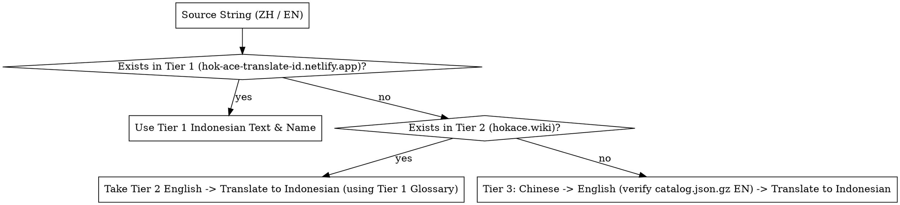

# HoK: Ace 3-Tier Translation Hierarchy

## Overview

All Indonesian translations MUST strictly follow the 3-Tier Reference Hierarchy defined below. Never invent terminology when an entry exists in Tier 1 or Tier 2.

## The 3-Tier Authority Rule

### Tier 1: Primary Indonesian Reference (`https://hok-ace-translate-id.netlify.app/`)

- **Extraction Method:** Fetch `https://hok-ace-translate-id.netlify.app/` and parse the two embedded JSON script tags:
  1. `<script id="data" type="application/json">`:
     - `hero` (85 items): `id`, `cn`, `name`, `tier`, `faction`, `desc` (ID), `descCn` (ZH), `kw`
     - `effect` (98 items): `id`, `cn`, `name`, `tier`, `faction`, `desc` (ID), `descCn` (ZH), `group`
     - `equip` (73 items): `id`, `cn`, `name`, `tier`, `faction`, `desc` (ID), `descCn` (ZH)
     - `talent` (258 items): `id`, `cn`, `name`, `tier`, `faction`, `desc` (ID), `descCn` (ZH)
     - `keywords` (14 items) & `factions` (9 items)
  2. `<script id="lords-data" type="application/json">`:
     - 19 Chessplayers/Lords (`name`, `talents[]` with `cardName` and Indonesian `desc`, `related[]` with `name` and Indonesian `desc`).
- **Terminology Style (Hybrid Indonesian-English):**
  - Keep Proper Names of Heroes (`Su Lie`, `Alessio`), Cards (`Talent Scouting`), Equipment (`Storm Greatsword`), Talents (`Copier`), Factions (`Central Plain`, `Riverlands`, `Sunset`, `Zhulu Plateau`, `Three Kingdoms`), and Core Mechanics (`Sacrifice`, `Temporary Level`, `Physical Damage`, `Magic Damage`, `True Damage`, `Attack Speed`, `Attack Power`, `Max HP`, `Shield`, `Stun`, `Silence`, `Disarm`, `Root`, `Knockback`, `Combat`, `Round`, `Shop`, `Refresh`, `Tier`) in English as established in Tier 1.
  - Translate card category terms and prose into natural Indonesian (`Kartu Hero`, `Kartu Efek`, `Kartu Secret Art`, `dapatkan`, `secara permanen`, `saat gugur`, `musuh terdekat`, `sekitarnya`).

### Tier 2: Secondary English Reference (`https://hokace.wiki/`)

- **Extraction Method:**
  - Fetch `https://hokace.wiki/search/` and extract `const entries = [...]` (624 items across `Talent`, `Effect card`, `Equipment`, `Hero`, `Chess player`, `Mechanic`, `Summon`).
  - Each entry contains `name` (EN), `alt` (ZH), `type`, `url`, and `search` (combined ZH + EN summary).
  - For detailed descriptions of items missing from Tier 1, fetch `https://hokace.wiki<url>` and `https://hokace.wiki/zh<url>`.
- **Translation Rule:** When an item is absent from Tier 1 but present in Tier 2, keep its Tier 2 English proper name and translate its English description into Indonesian using Tier 1's hybrid terminology rules.

### Tier 3: Fallback (`ZH -> EN -> ID`)

- **Scope:**
  1. All remaining ~40,000 strings in `catalog/catalog.json.gz` (`unique` and `english_updates`) and `wxq_patch` override modules (`hok_terminology.py`, `glossary.py`, `direct_*_overrides.py`).
  2. The **108 unknown Chinese strings (`409` records)** found in the user's live Windows game (`originals/WXQ_Data/Package/builtin`) that were missed by English Patcher 1.4.12.
- **Process:**
  1. For strings already in `catalog.json.gz`, use the Chinese key (`ZH`) + existing validated English value (`EN`) as the `ZH -> EN` bridge (correcting any proper-name discrepancies against Tier 1/Tier 2).
  2. For the 108 unknown Chinese strings in the game database, translate `ZH -> EN` first, then `EN -> ID`.
  3. Translate into clean, accurate Indonesian (`ID`) while strictly preserving all tags, placeholders, control tokens, and semicolons (see `wxq-tag-and-validation-guard`).
