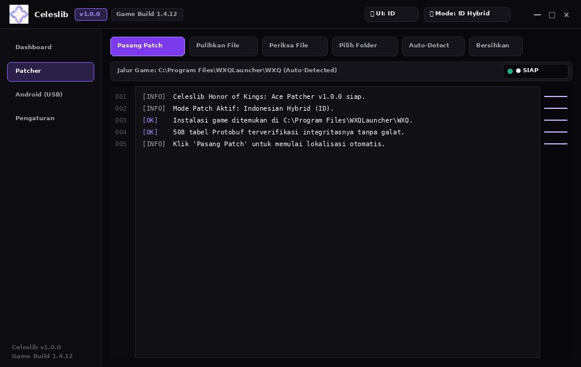
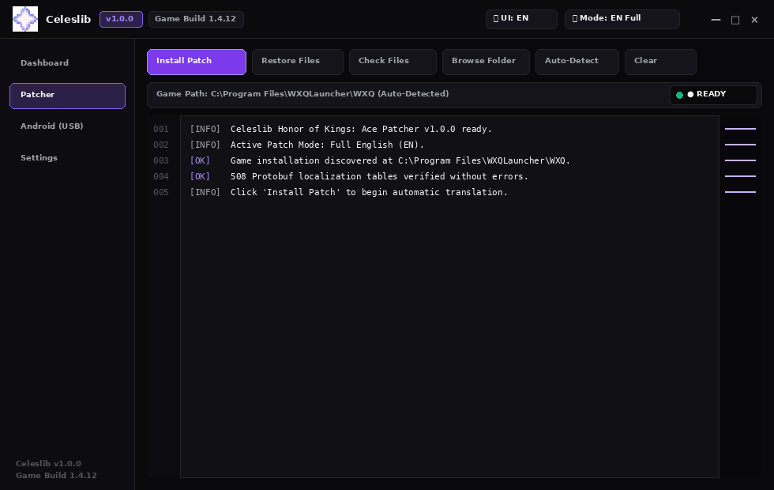

# Celeslib Honor of Kings: Ace Patcher (`v1.0.0` — Game Build `1.4.12`)

<p align="center">
  
</p>

Aplikasi pemasang *patch* lokalisasi resmi **Celeslib** untuk gim PC **Honor of Kings: Ace (`WXQ.exe`)**, dibangun dengan antarmuka native Windows x86-64 bergaya **Xeno v1.3.0 Ultra-Dark Carbon** (`#09090B` canvas, aksen violet `#8B5CF6`), pergantian bahasa UI real-time (**`🌐 UI: ID | EN`**), dan mode patch game fleksibel (**`🎯 Mode: ID Hybrid | EN Full`**).

---

## Pratinjau Antarmuka Xeno v1.3.0

| Mode Bahasa Indonesia (`UI: ID` • `Mode: ID Hybrid`) | Mode Bahasa Inggris (`UI: EN` • `Mode: EN Full`) |
| :---: | :---: |
|  |  |

---

## Fitur Utama

1. **Antarmuka Native Windows Xeno v1.3.0 (`Win32` + `GDI+` + `DWM Dark Mode`):**
   - Mengusung palet warna *Ultra-Dark Carbon* (`#09090B` background, `#0D0D11` sidebar, `#14141A` cards/buttons, `#24242E` border 1px, `#8B5CF6` Celeslib violet accent).
   - Custom header terintegrasi logo pixel-star resmi Celeslib, badge versi `v1.0.0`, target game badge `Game Build 1.4.12`, dan kontrol jendela (`—`, `□`, `×`).
   - Navigasi sidebar 4 tab: **Dashboard**, **Patcher**, **Android (USB)**, dan **Settings**.
   - Top action toolbar responsif: `▷ Pasang Patch / Install Patch`, `↺ Pulihkan File / Restore Files`, `🔍 Periksa File / Check Files`, `📁 Pilih Folder / Browse Folder`, `⚡ Auto-Detect`, `🗑 Bersihkan / Clear`.
   - Konsol diagnostik monospace bernomor baris (*editor-style line numbers gutter*) dengan status badges dan minimap strip di sisi kanan.

2. **Dua Mode Terjemahan Game (`🎯 Mode Patch`):**
   - **`ID Hybrid Gameplay` (Default):** Menerjemahkan seluruh deskripsi efek gameplay, kartu hero (*On Play*, *Sacrifice*, *Awaken*), skill aktif/pasif, talent cards, dan deskripsi kontestan ke Bahasa Indonesia, sementara nama hero/skill/talent dan sistem menu non-gameplay tetap dalam Bahasa Inggris standar.
   - **`EN Full English`:** Menerjemahkan 100% berkas ke Bahasa Inggris resmi (memulihkan gameplay ke English dan melengkapi string Mandarin yang belum diterjemahkan).
   - Penggantian mode otomatis melakukan *pre-install restore* dari cadangan `originals/` tanpa resiko tumpang tindih terjemahan.

3. **Pergantian Bahasa UI Real-Time (`🌐 Bahasa UI`):**
   - Quick header toggle **`[🌐 UI: ID | EN]`** dan kartu pengaturan interaktif pada menu **Settings** untuk berpindah antara Bahasa Indonesia dan English secara instan.
   - Laporan status `result.json` otomatis disajikan sesuai bahasa UI yang dipilih.

4. **Zero CPDD Branding Leakage:**
   - Seluruh biner luar, resources Windows PE, ikon multi-resolusi `.ico` (`16x16`..`256x256`), dan logo RGBA pre-decoded pre-rendered 100% menggunakan identitas resmi Celeslib tanpa kebocoran aset legacy.

5. **Integritas Biner & Transparansi Sertifikat:**
   - Penjaga digest SHA-256 64-karakter untuk memvalidasi integritas `ace-worker.exe` sebelum dieksekusi.
   - **Forensik Sertifikat:** Patcher beroperasi **100% offline** tanpa transmisi jaringan. Berkas `certifi/cacert.pem` yang ada di dalam PyInstaller hanya sertifikat Mozilla Root CA bawaan dependensi upstream Python, dan modul X.509 `cryptography` hanya digunakan secara lokal ketika menandatangani ulang APK Android pada mode USB.

---

## Cara Penggunaan (Windows 10 / 11 64-bit)

1. **Tutup gim `Honor of Kings: Ace` (`WXQ.exe`)** dan *launcher* sepenuhnya sebelum menjalankan *patcher*.
2. Unduh berkas rilis **`Celeslib-HoK-Ace-Patcher-v1.0.0.exe`** (atau salinan kompatibilitas `Honor-of-Kings-Ace-Indonesian-Patcher-1.4.12.exe`) dan **`SHA256SUMS.txt`** dari halaman [**GitHub Releases (`v1.0.0-celeslib`)**](https://github.com/voseu/acepatchindo/releases/tag/v1.0.0-celeslib).
3. Jalankan `Celeslib-HoK-Ace-Patcher-v1.0.0.exe` (klik **More info -> Run anyway** apabila muncul peringatan Windows SmartScreen).
4. Pilih mode patch yang diinginkan melalui header toggle **`[🎯 Mode]`** atau menu **Settings**.
5. Klik **`▷ Pasang Patch`** dan tunggu hingga proses verifikasi 508 tabel Protobuf selesai.
6. Untuk memulihkan file gim ke kondisi awal, buka aplikasi dan klik **`↺ Pulihkan File`**.

---

## Struktur Repositori & Kompilasi (Linux / MinGW-w64 / Python 3.12)

```text
├── assets/
│   ├── branding/                      # celeslib.ico (multi-size), celeslib_logo_512/64/32.png
│   └── previews/                      # xeno_patcher_id.png, xeno_patcher_en.png
├── data/references/                   # Ekstraksi referensi Tier 1 (ID), Tier 2 (EN), hybrid_vfs_index.json
├── scripts/
│   ├── 07_build_celeslib_assets.py    # Ekstraksi logo Celeslib & pembuatan header C++ BGRA
│   ├── 08_compile_xeno_gui.py         # Kompilasi Win32 GUI stub MinGW-w64 & render preview
│   ├── 03_patch_worker_modules.py     # Kompilasi modul Python 3.12 Dual-State
│   ├── 04_verify_real_windows_game.py # Verifikasi 508 tabel Protobuf terhadap file asli gim
│   ├── 05_repack_windows_exe.py       # Pengemasan deterministik Celeslib Release Executable
│   └── 06_publish_github_release.py   # Publikasi rilis GitHub v1.0.0-celeslib
├── src/
│   ├── acepatchindo/                  # Engine klasifikasi hybrid, leksikon, & dual-state bytecode
│   └── gui/                           # celeslib_xeno_gui.cpp, celeslib_xeno.rc, celeslib_xeno_i18n.h
└── tests/                             # Rangkaian pengujian integritas PE, branding, & dual-state engine
```

### Membangun dari Kode Sumber

```bash
# 1. Ekstrak aset branding Celeslib
uv run --python 3.12 python scripts/07_build_celeslib_assets.py

# 2. Kompilasi GUI native Xeno v1.3.0
uv run --python 3.12 python scripts/08_compile_xeno_gui.py

# 3. Patch worker modules & rakit executable rilis
uv run --python 3.12 python scripts/03_patch_worker_modules.py
uv run --python 3.12 python scripts/05_repack_windows_exe.py

# 4. Jalankan seluruh pengujian unit & integrasi
uv run --python 3.12 pytest -v
```

---

## Verifikasi Integritas (`SHA-256`)

| Berkas / Komponen | Ukuran (Byte) | SHA-256 |
| :--- | ---: | :--- |
| `Celeslib-HoK-Ace-Patcher-v1.0.0.exe` | `55.061.024` | `1e4ef69346602343d7d13a5d407d18540cce363118fd833f7019f739d0297261` |
| `Honor-of-Kings-Ace-Indonesian-Patcher-1.4.12.exe` | `55.061.024` | `1e4ef69346602343d7d13a5d407d18540cce363118fd833f7019f739d0297261` |
| `ace-worker.exe` (*embedded payload*) | `53.927.862` | `abbfffec6bab992b31c25e32dc8a33571fd5f279033185f84361af87632253f2` |
