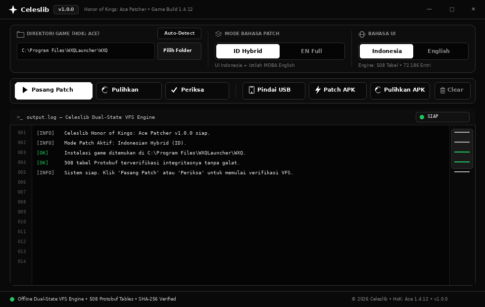
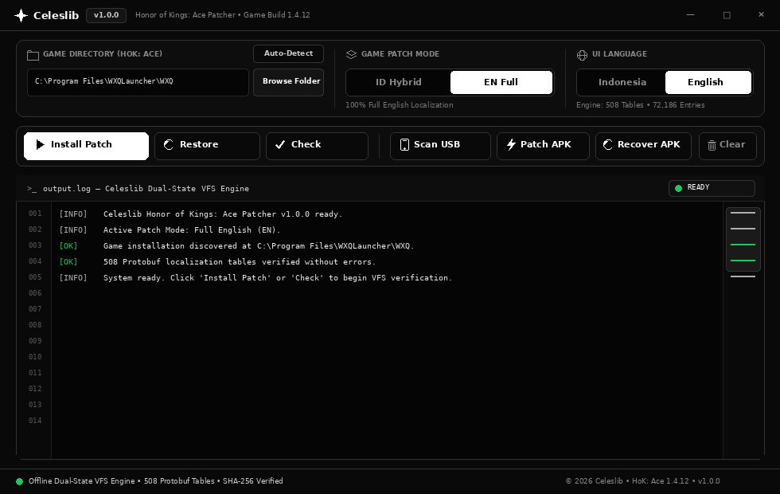

# Celeslib Honor of Kings: Ace Patcher (`v1.0.0` — Game Build `1.4.12`)

  

Aplikasi *patcher* lokalisasi resmi **Celeslib** untuk menerjemahkan gim **Honor of Kings: Ace (`WXQ.exe`)** di PC dan Android (USB) ke Bahasa Indonesia maupun Bahasa Inggris.

| Mode Bahasa Indonesia (`UI: Indonesia` • `Mode: ID Hybrid`) | Mode Bahasa Inggris (`UI: English` • `Mode: EN Full`) |
| :---: | :---: |
|  |  |

---

## Fungsi Patcher

1. **Pilihan Mode Bahasa Patch (`ID Hybrid` / `EN Full`):**
   - **`ID Hybrid`:** Menerjemahkan seluruh deskripsi efek kartu hero, skill aktif/pasif, talent, dan efek gameplay ke **Bahasa Indonesia**, sedangkan nama hero/skill dan menu utama tetap dalam Bahasa Inggris.
   - **`EN Full`:** Menerjemahkan seluruh teks gim ke **Bahasa Inggris** penuh.
2. **Manajemen Patch PC:**
   - **`Auto-Detect` & `Pilih Folder`:** Mendeteksi folder instalasi gim secara otomatis atau memilih folder `WXQ` secara manual.
   - **`Pasang Patch`:** Memasang terjemahan gim sesuai mode bahasa yang dipilih.
   - **`Pulihkan`:** Mengembalikan berkas gim ke kondisi asli sebelum di-patch.
   - **`Periksa`:** Memeriksa status instalasi dan memverifikasi berkas gim.
3. **Patching Perangkat Android (USB):**
   - **`Pindai USB`:** Mendeteksi perangkat Android yang terhubung melalui USB Debugging (ADB).
   - **`Patch APK` & `Pulihkan APK`:** Memasang patch bahasa atau memulihkan instalasi gim di perangkat Android.
4. **Pilihan Bahasa Antarmuka (`Indonesia` / `English`):**
   - Mengganti bahasa tampilan aplikasi dan log status secara instan antara Bahasa Indonesia dan Bahasa Inggris.

---

## Cara Penggunaan

1. Tutup gim **Honor of Kings: Ace (`WXQ.exe`)** dan *launcher* sepenuhnya.
2. Unduh **`Celeslib-HoK-Ace-Patcher-v1.0.0.exe`** dari halaman [**GitHub Releases (`v1.0.0-celeslib`)**](https://github.com/voseu/acepatchindo/releases/tag/v1.0.0-celeslib).
3. Jalankan aplikasi, pastikan folder gim sudah terdeteksi (atau klik **`Auto-Detect`** / **`Pilih Folder`**).
4. Pilih **`ID Hybrid`** atau **`EN Full`**, lalu klik **`Pasang Patch`**.
5. Untuk mengembalikan berkas gim ke kondisi semula, klik **`Pulihkan`**.

---

## Verifikasi Integritas (`SHA-256`)

| Berkas | Ukuran (Byte) | SHA-256 |
| :--- | ---: | :--- |
| `Celeslib-HoK-Ace-Patcher-v1.0.0.exe` | `55.094.304` | `8850b5c4ab740dd4abd066dbdbe524a30c5c091a801da34f4ea27397a9c29670` |
| `ace-worker.exe` (*embedded payload*) | `53.927.862` | `244328b82e6e63691f0525a244a5bcc80f9fce4eb71d6e85c0de023afca7eafa` |
